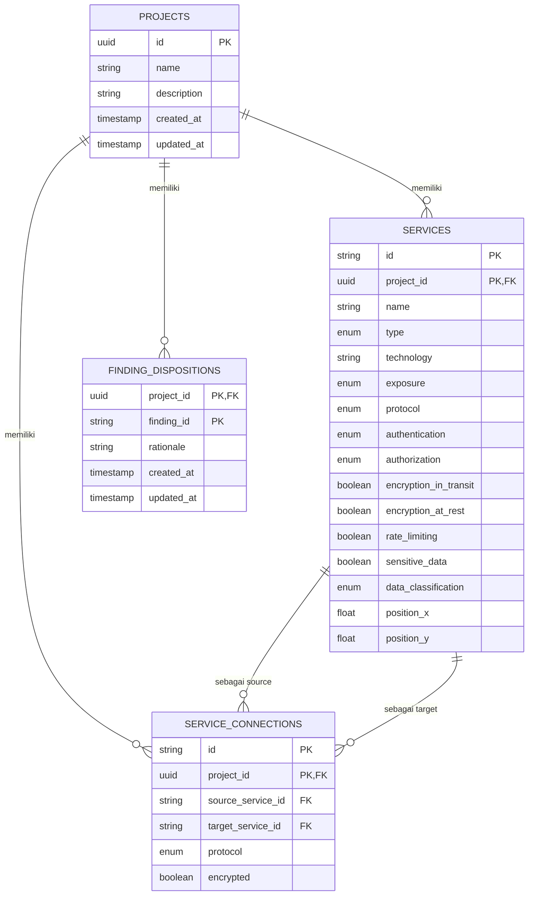

# AttackMap — Product Requirements Document (PRD)

> **Dokumen Kontrol Produk**  
> **Nama Produk:** AttackMap  
> **Versi Dokumen:** 1.0 (Human-Centered Baseline)  
> **Status:** Disetujui & Terverifikasi Penuh (*Approved / Production Baseline*)  
> **Target Rilis:** MVP (*Minimum Viable Product* — Milestone 0 s/d Milestone 7)  
> **Platform & Teknologi:** Desktop-Oriented Local-First Web Application (Next.js 16 App Router, React 19, TypeScript, PostgreSQL, Drizzle ORM, Tailwind CSS v4, @xyflow/react)  
> **Kategori Produk:** *Application Security / Security Architecture / Interactive Threat Modeling*

---

## Ringkasan Eksekutif (*Executive Summary*)

**AttackMap** adalah aplikasi web pemodelan arsitektur keamanan aplikasi (*interactive application security architecture tool*) lokal (*local-first*) yang dirancang khusus untuk memecahkan dilema mendasar tim rekayasa perangkat lunak: **sulitnya memvisualisasikan attack surface, tingginya hambatan threat modeling konvensional yang kaku dan mudah usang (*stale*), serta lambatnya umpan balik risiko keamanan saat keputusan desain arsitektur diambil.**

Threat modeling tradisional sering kali dilakukan secara terisolasi menggunakan spreadsheet, dokumen teks tebal, atau papan tulis (*whiteboard*). Pendekatan ini memiliki kelemahan fatal: dokumentasi cepat usang begitu kode berubah, memerlukan keahlian mendalam di bidang pentesting, dan sama sekali tidak terhubung secara visual dengan konfigurasi nyata komponen arsitektur.

AttackMap mengubah paradigma ini dengan menyatukan tiga pilar utama dalam satu ruang kerja visual (*unified workspace*):

$$\text{Visual Canvas} + \text{Deterministic Risk Engine} + \text{Findings \& Triage Workflow}$$

**AttackMap bukan vulnerability scanner dan tidak melakukan active scanning, network probing, penyerangan otomatis, atau eksploitasi terhadap infrastruktur pengguna.** Sebagai gantinya, pengguna merancang graf sistem (layanan, basis data, gateway, antrean pesan, dan koneksinya), menetapkan atribut keamanan (eksposur jaringan, protokol transmisi, metode autentikasi, model otorisasi, enkripsi, dan sensitivitas data), lalu engine deterministik murni akan mengevaluasi topologi arsitektur secara instan (< 1 ms di memori browser), memberikan skor postur keamanan teknis objektif (0–100), mendeteksi salah konfigurasi (*security misconfigurations*), dan memberikan rekomendasi mitigasi yang dapat langsung dieksekusi oleh developer.

```
+----------------------------------------------------------------------------------------------------+
|                         NILAI UTAMA RUANG KERJA VISUAL ATTACKMAP                                   |
+----------------------------------------------------------------------------------------------------+
|                                                                                                    |
|    [ PEMODELAN ARSITEKTUR KANVAS ]               [ EVALUASI KEAMANAN DETERMINISTIK ]               |
|    - Visual drag-and-drop React Flow             - 10 aturan dasar baseline (AM-001 s/d AM-010)   |
|    - 12 tipe node domain (API, DB, Web, Queue)   - Pure functional evaluation (tanpa latency I/O)  |
|    - Koneksi terarah & protokol transmisi        - Identifikasi attack surface & trust boundary    |
|    - Atribut keamanan mendalam (Auth, Crypto)    - Rekomendasi mitigasi praktis bagi engineer     |
|                                                                                                    |
|                                 \                     /                                            |
|                                  \                   /                                             |
|                                   v                 v                                              |
|                         +-----------------------------------+                                      |
|                         |      UNIFIED WORKSPACE ENGINE     |                                      |
|                         |  - Raw Technical Score (0 - 100)  |                                      |
|                         |  - Findings Triage & Audit Rationale|                                    |
|                         |  - Debounced Autosave (1500 ms)   |                                      |
|                         |  - Executive Security Overview    |                                      |
|                         +-----------------------------------+                                      |
|                                                                                                    |
+----------------------------------------------------------------------------------------------------+
```

---

## Daftar Isi

1. [Latar Belakang & Analisis Masalah](#1-latar-belakang--analisis-masalah)
2. [Visi Produk, Nilai Inti & Sasaran Sukses](#2-visi-produk-nilai-inti--sasaran-sukses)
3. [Batasan Cakupan Produk (Scope Boundaries & Non-Goals)](#3-batasan-cakupan-produk-scope-boundaries--non-goals)
4. [Persona Pengguna & Cerita Pengguna (User Stories)](#4-persona-pengguna--cerita-pengguna-user-stories)
5. [Alur Pengguna & Pengalaman Antarmuka (User Journey & UX)](#5-alur-pengguna--pengalaman-antarmuka-user-journey--ux)
6. [Kebutuhan Fungsional Produk (Functional Requirements)](#6-kebutuhan-fungsional-produk-functional-requirements)
7. [Model Data Konseptual (Data Dictionary)](#7-model-data-konseptual-data-dictionary)
8. [Filosofi Keamanan & Prinsip Penilaian (Scoring Philosophy)](#8-filosofi-keamanan--prinsip-penilaian-scoring-philosophy)
9. [Kebutuhan Non-Fungsional (Kualitas Sistem)](#9-kebutuhan-non-fungsional-kualitas-sistem)
10. [Panduan Desain Antarmuka & Sistem Visual](#10-panduan-desain-antarmuka--sistem-visual)
11. [Kriteria Penerimaan & Skenario Sukses (Acceptance Criteria)](#11-kriteria-penerimaan--skenario-sukses-acceptance-criteria)
12. [Rencana Rilis & Milestone Roadmap (M0 s/d M7)](#12-rencana-rilis--milestone-roadmap-m0-sd-m7)
13. [Manajemen Risiko & Pertimbangan Desain](#13-manajemen-risiko--pertimbangan-desain)

---

## 1. Latar Belakang & Analisis Masalah

### 1.1 Masalah Fundamental dalam Pemodelan Keamanan Arsitektur
Dalam siklus hidup rekayasa perangkat lunak modern (*Secure SDLC*), pengembang dan arsitek sistem menghadapi sejumlah rintangan serius:

1. **Diagram Arsitektur yang "Buta Keamanan" (*Security-Blind Architecture*):**  
   Diagram teknis yang digambar di Miro, Draw.io, atau Visio hanya memperlihatkan aliran kotak dan panah fungsional (*"Service A memanggil Service B"*). Diagram tersebut tidak menangkap metadata penting: apakah port database terekspos ke internet publik, apakah data sensitif ditransmisikan tanpa enkripsi, atau apakah token JWT divalidasi dengan otorisasi berbasis peran (RBAC).
2. **Threat Modeling yang Terisolasi dan Cepat Usang (*Stale Documentation*):**  
   Aktivitas threat modeling biasanya dilakukan di awal proyek di atas spreadsheet Excel yang rumit. Begitu arsitektur berevolusi di fase pengembangan, spreadsheet tersebut tidak pernah diperbarui lagi dan menjadi artefak mati yang tidak mencerminkan realitas produksi.
3. **Kesenjangan Bahasa antara Developer dan Pentester (*The Jargon Barrier*):**  
   Laporan uji penetrasi sering kali penuh dengan istilah eksploitasi yang menakutkan tanpa menjelaskan akar masalah arsitekturalnya secara sederhana. Developer membutuhkan alat yang memberikan rekomendasi konkret: *"Ubah eksposur database menjadi private"* atau *"Aktifkan enkripsi at-rest untuk data confidential"*.
4. **Ilusi Keamanan Palsu dari "Menerima Risiko" (*The False Sense of Security*):**  
   Pada platform manajemen risiko konvensional, saat seorang manajer menandai temuan sebagai *"Accepted Risk"*, skor keamanan sistem sering kali dinaikkan secara artifisial kembali ke 100. Hal ini menyembunyikan fakta teknis bahwa celah keamanan di jaringan masih tetap terbuka.

### 1.2 Solusi AttackMap
AttackMap memadukan kebebasan menggambar diagram arsitektur dengan mesin evaluasi risiko otomatis:
* **Visual-First Security Modeling:** Pengguna memanipulasi diagram interaktif berbasis node dan koneksi terarah secara visual.
* **Instant In-Memory Feedback:** Evaluasi aturan keamanan berjalan secara murni (*pure derived computation*) dalam waktu kurang dari 1 milidetik di memori, memberikan skor dan temuan secara seketika saat atribut diubah.
* **Raw Technical Posture Integrity:** Skor keamanan (0–100) murni mencerminkan kondisi teknis arsitektur. Keputusan bisnis *Accepted Risk* dicatat dengan alasan (*rationale*) wajib di database untuk audit, namun tidak memanipulasi skor teknis.
* **Autosave Tanpa Konflik Konkurensi:** Koordinator penyimpanan otomatis di latar belakang (*autosave coordinator*) dengan jeda 1500 ms, perbandingan sidik jari (*fingerprint*), dan pelacakan generasi (*generation guard*) memastikan diagram selalu aman tanpa membanjiri database.

---

## 2. Visi Produk, Nilai Inti & Sasaran Sukses

### 2.1 Visi Produk
> *"Menjadi instrumen visual pemodelan arsitektur keamanan standar industri bagi developer dan arsitek perangkat lunak, yang mengubah threat modeling dari dokumen statis yang membosankan menjadi bagian alami, intuitif, dan terintegrasi dari desain arsitektur harian."*

### 2.2 Delapan Aturan Inti Produk (*Core Invariants*)

```text
1. VISUAL FIRST              — Diagram arsitektur adalah kanvas utama dan pusat pengalaman pengguna.
2. NOISELESS SECURITY        — Temuan keamanan harus deterministik, relevan, dan bebas dari false-positive.
3. EXPLAIN, DON'T SCARE      — Setiap temuan wajib menjelaskan risiko, dampak, dan mitigasi secara konkret.
4. PURE DERIVED FINDINGS     — Temuan dan skor dihitung di memori; tidak disimpan sebagai record statis di DB.
5. RAW TECHNICAL POSTURE     — Menerima risiko (Accepted Risk) adalah audit bisnis, bukan perbaikan teknis.
6. STABLE FINDING IDENTITY   — Identitas temuan terikat pada ID entitas, bukan nama visual yang dinamis.
7. ATOMIC SNAPSHOT SAVE      — Seluruh graf disimpan dalam transaksi ACID (delete-and-reinsert terikat batas).
8. NO ACTIVE SCANNING        — AttackMap menganalisis model desain; tidak memindai port atau mengeksploitasi target.
```

### 2.3 Sasaran Kualitatif & Kuantitatif Produk (G-01 – G-05)

| ID | Sasaran Produk | Indikator Keberhasilan (Target KPI) | Cara Evaluasi |
|---|---|---|---|
| **G-01** | **Kecepatan Evaluasi Risiko** | Perhitungan 10 aturan keamanan dan skor selesai dalam < 1 milidetik. | Benchmark eksekusi *pure function* `analyzeArchitecture()` di Node/Browser. |
| **G-02** | **Integritas Penilaian Teknis** | 100% konsistensi skor teknis murni (skor tidak berubah saat temuan di-triage menjadi Accepted Risk). | Pengujian unit `scoring.test.ts` dan `finding-dispositions.test.ts`. |
| **G-03** | **Keandalan Autosave Klien** | 0% insiden penimpaan data usang (*stale overwrite*) akibat race condition jaringan. | Pengujian simulasi konkurensi asinkron di `autosave-coordinator.test.ts`. |
| **G-04** | **Ketahanan Batas Kuota** | 100% penolakan terhadap diagram raksasa ilegal (> 50 layanan atau > 100 koneksi) di tingkat server. | Verifikasi schema mapper dan referential integrity test. |
| **G-05** | **Aksesibilitas & Kerapian Visual**| Antarmuka bebas dari horizontal scrollbar yang tidak diinginkan dan mendukung navigasi keyboard ARIA. | Pengujian visual layout dan kepatuhan atribut semantik ARIA. |

---

## 3. Batasan Cakupan Produk (Scope Boundaries & Non-Goals)

```
+----------------------------------------------------------------------------------------------------+
|                                    MATRIKS RUANG LINGKUP MVP                                       |
+----------------------------------------------------+-----------------------------------------------+
|               DI DALAM CAKUPAN (IN-SCOPE)          |           DI LUAR CAKUPAN (NON-GOALS)         |
+----------------------------------------------------+-----------------------------------------------+
| - Kanvas visual arsitektur (@xyflow/react)         | - Vulnerability scanner aktif (Nessus/OpenVAS)|
| - Palet komponen (12 tipe service domain)          | - Port scanner jaringan (Nmap/Masscan)        |
| - Inspektor properti keamanan service & koneksi    | - Dynamic Application Security Testing (DAST) |
| - Mesin evaluasi risiko 10 aturan baseline (AM-010)| - Source code scanner / SAST (SonarQube/Semgrep)|
| - Kalkulasi skor keamanan teknis murni (0–100)     | - Eksekusi eksploitasi aktif ke server nyata  |
| - Triage temuan (Open vs Accepted Risk + Rationale)| - Impor infrastruktur cloud otomatis (AWS/GCP)|
| - Persistensi snapshot graf PostgreSQL (Drizzle)   | - Parsing file Terraform / Kubernetes YAML    |
| - Manajemen Multi-Project (/projects/[projectId])  | - Kolaborasi multiplayer realtime (WebSocket) |
| - Autosave Coordinator (Debounce 1500ms + Guard)   | - Sistem otentikasi multi-tenant / SSO / Tim  |
| - Project Security Overview (Top 5 Priority Risks) | - Ekspor laporan eksekutif PDF komersial      |
+----------------------------------------------------+-----------------------------------------------+
```

### 3.1 Alasan Pemilihan Non-Goals (*Product Rationale*)
* **Mengapa tidak ada scanning jaringan aktif (*No Port/Vulnerability Scanner*)?**  
  AttackMap adalah alat desain arsitektur preventif (*shift-left architecture tool*). Memindai target aktif memerlukan izin legalitas khusus, berisiko melumpuhkan server produksi, dan tidak dapat digunakan pada tahap perencanaan ketika kode belum ditulis.
* **Mengapa tidak ada impor otomatis Terraform / Cloud?**  
  Tujuan utama MVP adalah membangun fondasi model domain, aturan evaluasi risiko graf, dan pengalaman pemodelan interaktif yang solid. Fitur impor infrastruktur eksternal merupakan kandidat untuk iterasi rilis lanjutan.
* **Mengapa belum ada sistem akun pengguna (*No Authentication/SSO*)?**  
  MVP difokuskan sebagai instrumen portofolio dan utilitas lokal mandiri (*local workstation tool*) yang cepat dijalankan oleh satu developer tanpa keharusan membuat akun atau mengonfigurasi penyedia identitas OAuth eksternal.

---

## 4. Persona Pengguna & Cerita Pengguna (User Stories)

### 4.1 Persona Pengguna

```
+----------------------------------------------------+-----------------------------------------------+
| PERSONA 1: SOFTWARE DEVELOPER (FARHAN)             | PERSONA 2: SECURITY ARCHITECT (NABILAH)       |
+----------------------------------------------------+-----------------------------------------------+
| Profil:                                            | Profil:                                       |
| - Full-stack Software Engineer (26 th)             | - Lead AppSec & Security Architect (34 th)    |
| - Sedang mendesain sistem microservices baru       | - Mengaudit desain sistem sebelum disetujui   |
| Kebutuhan:                                         | Kebutuhan:                                    |
| - Diagram arsitektur yang mudah digambar           | - Memeriksa perimeter attack surface publik  |
| - Peringatan langsung jika ada salah konfigurasi   | - Mengidentifikasi aliran data rahasia        |
| - Saran perbaikan yang jelas tanpa jargon rumit    | - Triage risiko dengan catatan bisnis resmi   |
| Titik Frustrasi:                                   | Titik Frustrasi:                              |
| - Dokumen threat modeling dari tim security kaku   | - Developer sering mengekspos DB ke publik    |
| - Tidak tahu dampak keamanan dari pemilihan HTTP   | - Menerima risiko di Excel sering disalahpahami|
+----------------------------------------------------+-----------------------------------------------+
```

### 4.2 Matriks Cerita Pengguna (*User Stories*)

| ID | Sebagai... | Saya Ingin... | Agar... | Prioritas |
|---|---|---|---|:---:|
| **US-01** | Pengguna | Membuat proyek arsitektur baru dengan nama dan deskripsi | Saya dapat mengisolasi pemodelan untuk sistem yang berbeda. | **P0 (Must)** |
| **US-02** | Pengguna | Menyeret komponen layanan dari palet ke kanvas | Saya dapat menyusun tata letak arsitektur sistem secara visual. | **P0 (Must)** |
| **US-03** | Pengguna | Menghubungkan dua layanan dengan panah berarah | Aliran data dan hubungan dependensi sistem terdefinisi jelas. | **P0 (Must)** |
| **US-04** | Pengguna | Mengonfigurasi eksposur jaringan (public, private, internal) | Sistem dapat mendeteksi apakah komponen terekspos ke internet. | **P0 (Must)** |
| **US-05** | Pengguna | Mengonfigurasi metode autentikasi dan model otorisasi | Potensi bypass autentikasi dan akses tidak berhak terdeteksi. | **P0 (Must)** |
| **US-06** | Pengguna | Mengatur status enkripsi in-transit dan at-rest | Sistem mendeteksi transmisi data polos (*cleartext transmission*). | **P0 (Must)** |
| **US-07** | Pengguna | Menandai layanan sebagai pembawa data sensitif (*confidential*) | Aturan perlindungan data khusus dapat diaktifkan otomatis. | **P0 (Must)** |
| **US-08** | Pengguna | Melihat daftar temuan risiko seketika setelah mengubah diagram | Saya mendapat umpan balik langsung tanpa perlu menekan tombol scan. | **P0 (Must)** |
| **US-09** | Pengguna | Melihat skor postur keamanan teknis (0–100) dan kategorinya | Saya mengetahui tingkat kesehatan arsitektur secara objektif. | **P0 (Must)** |
| **US-10** | Pengguna | Menerima risiko (*Accept Risk*) pada temuan dengan alasan wajib | Keputusan bisnis terdokumentasi tanpa merusak integritas skor. | **P0 (Must)** |
| **US-11** | Pengguna | Mengandalkan penyimpanan otomatis (*autosave*) saat mengedit | Perubahan diagram tidak hilang tanpa harus selalu klik tombol simpan. | **P0 (Must)** |
| **US-12** | Pengguna | Membuka tab *Security Overview* untuk melihat ringkasan metrik | Stakeholder eksekutif dapat melihat 5 risiko prioritas teratas. | **P0 (Must)** |
| **US-13** | Pengguna | Mendapatkan dialog konfirmasi modal saat menghapus komponen | Saya tidak kehilangan node atau proyek berharga akibat salah klik. | **P1 (Should)** |

---

## 5. Alur Pengguna & Pengalaman Antarmuka (User Journey & UX)

### 5.1 Alur Utama Pembuatan & Pemodelan Proyek (*Project Modeling Flow*)

```
[ Buka Halaman /projects ]
       ↓
[ Klik "New Project" ] ──> Masukkan Nama & Deskripsi ──> Submit Server Action
       ↓
[ Masuk ke /projects/[projectId] ] ──> Workspace Termuat (Initial State)
       ↓
[ Interaksi Kanvas Arsitektur (Tab: Architecture) ]
  ├── 1. Seret Service dari Palet Komponen (misal: "Web Application", "Database")
  ├── 2. Hubungkan Node: Internet ──> Web App ──> Database (ServiceConnection)
  ├── 3. Klik Node untuk Membuka Service Inspector (Panel Kanan)
  └── 4. Sesuaikan Atribut: Exposure=Public, Auth=None, Encryption=False
       ↓
[ Evaluasi Deterministik Murni Terpicu Otomatis (RAM Klien) ]
  ├── analyzeArchitecture(services, connections) ──> Dihasilkan Findings[]
  ├── calculateSecurityScore(findings) ──> Skor Terhitung (Misal: 40/100 - High Risk)
  └── Badge Skor Keamanan & Indikator Temuan di Header Langsung Diperbarui
       ↓
[ Autosave Coordinator Terpicu di Latar Belakang ]
  ├── 1500 ms Debounce Timer Berjalan
  └── Status Autosave: saved ──> unsaved ──> saving ──> saved
```

### 5.2 Alur Triage Temuan & Menerima Risiko (*Findings Triage Flow*)

```
[ Pindah ke Tab "Findings" di Workspace ]
       ↓
[ Daftar Temuan Aktif Ditampilkan Terurut Berdasarkan Severity (Critical -> Low) ]
       ↓
[ Pengguna Memilih Temuan: "AM-001: Public database exposure" ]
       ↓
[ Baca Deskripsi Risiko & Rekomendasi Mitigasi ]
       │
       ├── Opsi A: Pengguna Memperbaiki Arsitektur
       │     Kembali ke Kanvas ──> Ubah Exposure menjadi "Private"
       │     Temuan AM-001 otomatis hilang (*Auto-Resolved*) & Skor Naik ke 60
       │
       └── Opsi B: Pengguna Memutuskan Menerima Risiko (Accepted Risk)
             Klik Tombol "Accept Risk"
             Masukkan Rationale (Wajib 1 - 1000 Karakter)
             Submit Disposisi ke Server Action (acceptFindingRiskAction)
             Status Visual Temuan Berubah Menjadi: "Accepted Risk"
             *Catatan: Skor Teknis Tetap 40/100 (Prinsip Raw Technical Posture)*
```

### 5.3 Spesifikasi Ruang Kerja Antarmuka (*Unified Workspace Structure*)

Ruang kerja AttackMap dirancang terpadu dalam satu URL rute (`/projects/[projectId]`) dengan 3 tab navigasi atas:

#### 1. Tab Kanvas Arsitektur (*Architecture View*)
* **Panel Kiri (Component Palette):** Menampilkan daftar 7 tipe komponen yang siap ditarik ke kanvas (*Web App, Mobile App, API, API Gateway, Backend Service, Auth Service, Database*).
* **Area Tengah (React Flow Canvas):** Bidang kanvas monokrom luas untuk menggeser node, menghubungkan port koneksi, memperbesar/memperkecil (*pan/zoom*), dan memilih elemen.
* **Panel Kanan (Inspector Panel):**
  - Jika node dipilih: Menampilkan *Service Inspector* (nama, teknologi, exposure, protokol, metode autentikasi, model otorisasi, sakelar enkripsi in-transit & at-rest, rate limiting, data sensitivity, klasifikasi data, dan tombol hapus node dengan modal konfirmasi).
  - Jika koneksi dipilih: Menampilkan *Connection Inspector* (protokol transmisi: HTTPS/HTTP/gRPC/TCP/WebSocket, sakelar enkripsi, dan tombol putus koneksi).
* **Header Bar:** Menampilkan nama proyek, tautan kembali ke daftar proyek, lencana skor keamanan real-time, lencana status autosave (*saved, unsaved, saving, error*), dan tombol manual *Save/Reload*.

#### 2. Tab Ringkasan Keamanan (*Security Overview View*)
* **Kartu Skor Keamanan Terpadu:** Menampilkan nilai numerik besar (0–100), kategori status (*Strong, Good, Moderate, High-Risk, Critical-Risk*), dan bilah kemajuan (*progress bar*).
* **Grid Distribusi Temuan:** Ringkasan jumlah temuan aktif berdasarkan keparahan (*Critical, High, Medium, Low*) dan distribusi status disposisi (*Open vs Accepted Risk*).
* **Metrik Komposisi Arsitektur:** Jumlah total layanan dan total koneksi aktif.
* **Daftar 5 Temuan Prioritas Teratas (*Top 5 Priority Findings*):** Kartu ringkas yang menampilkan risiko paling mendesak yang harus diselesaikan oleh engineer.

#### 3. Tab Daftar Temuan (*Findings View*)
* **Filter Status Triage:** Tombol alih untuk menyaring temuan (*All, Open, Accepted Risk*).
* **Daftar Kartu Temuan:** Setiap kartu memuat label severity dengan warna terkalibrasi, judul aturan, ID target yang terdampak, deskripsi mendalam, rekomendasi perbaikan, serta formulir aksi penerimaan risiko (*Accept Risk Form*) lengkap dengan textarea alasan bisnis.

---

## 6. Kebutuhan Fungsional Produk (Functional Requirements)

### 6.1 Manajemen Kanvas & Graf Arsitektur (FR-CANVAS)

| ID | Nama Kebutuhan | Deskripsi & Aturan Bisnis |
|---|---|---|
| **FR-CANVAS-01** | Kanvas Interaktif | Menyediakan kanvas graf visual menggunakan `@xyflow/react` dengan kontrol pan, zoom, seleksi node, dan multi-node drag. |
| **FR-CANVAS-02** | Palet Komponen | Menyediakan palet komponen untuk membuat 7 tipe layanan creatable: `internet`, `web`, `gateway`, `api`, `auth`, `database`, `storage`. |
| **FR-CANVAS-03** | Pembatasan Kapasitas | Membatasi ukuran arsitektur per-proyek maksimal **50 layanan** dan **100 koneksi** demi menjaga performa rendering dan batas transaksi DB. |
| **FR-CANVAS-04** | Koneksi Terarah (*Edges*) | Memungkinkan pembuatan koneksi terarah (*directed connection*) antar layanan dengan snapping otomatis pada handle node. |
| **FR-CANVAS-05** | Pencegahan Self-Loop | Sistem secara ketat menolak pembuatan koneksi di mana simpul sumber identik dengan simpul target (`source !== target`). |
| **FR-CANVAS-06** | Pencegahan Duplikasi Koneksi| Menolak pembuatan lebih dari satu koneksi dengan pasangan simpul sumber dan target yang sama dalam satu proyek. |

### 6.2 Konfigurasi Inspektor Keamanan (FR-INSPECTOR)

| ID | Nama Kebutuhan | Deskripsi & Aturan Bisnis |
|---|---|---|
| **FR-INSPECTOR-01** | Atribut Node Lengkap | Mengizinkan penyuntingan atribut layanan: `name`, `technology`, `exposure` (public/private/internal), `protocol`, `authentication`, `authorization`, `encryptionInTransit`, `encryptionAtRest`, `rateLimiting`, `sensitiveData`, `dataClassification`. |
| **FR-INSPECTOR-02** | Atribut Koneksi Lengkap | Mengizinkan penyuntingan atribut koneksi: `protocol` (https, http, grpc, tcp, websocket) dan status `encrypted`. |
| **FR-INSPECTOR-03** | Sinkronisasi Posisi Kanvas | Koordinat visual ($X, Y$) dari setiap node dilacak dan disinkronkan langsung ke model snapshot untuk disimpan ke database. |
| **FR-INSPECTOR-04** | Dialog Konfirmasi Hapus | Menampilkan dialog modal konfirmasi sebelum menghapus node atau koneksi dari kanvas untuk mencegah salah klik. |

### 6.3 Mesin Analisis Risiko Deterministik (FR-RULE)

| ID | Nama Kebutuhan | Deskripsi & Aturan Bisnis |
|---|---|---|
| **FR-RULE-01** | 10 Aturan Baseline Aktif | Menerapkan 10 aturan deterministik: `AM-001` s/d `AM-010` yang mencakup eksposur database, autentikasi API, otorisasi, enkripsi, dan rate limiting. |
| **FR-RULE-02** | Evaluasi Pure Functional | Mesin aturan diimplementasikan sebagai fungsi murni `analyzeArchitecture(services, connections)` yang beroperasi tanpa efek samping I/O. |
| **FR-RULE-03** | Identitas Temuan Stabil | Setiap temuan memiliki format ID deterministik yang stabil: `{ruleId}:service:{serviceId}` atau `{ruleId}:connection:{connectionId}`. |
| **FR-RULE-04** | Deduplikasi Temuan | Mesin menjamin tidak ada temuan ganda untuk aturan dan entitas target yang sama. |
| **FR-RULE-05** | Evaluasi Topologi Lintas-Node| Aturan `AM-008` mengevaluasi atribut kedua ujung koneksi (koneksi tidak terenkripsi di mana source atau target menangani data sensitif). |

### 6.4 Penilaian Postur & Triage Temuan (FR-SCORE & FR-TRIAGE)

| ID | Nama Kebutuhan | Deskripsi & Aturan Bisnis |
|---|---|---|
| **FR-SCORE-01** | Skor Teknis Berbobot | Menghitung skor dari basis 100 dengan penalti: Critical (-20), High (-10), Medium (-5), Low (-2), dengan batas bawah 0. |
| **FR-SCORE-02** | Kategori Skor Objektif | Mengelompokkan skor ke dalam 5 pita kategori: Strong (90-100), Good (75-89), Moderate (50-74), High-Risk (25-49), Critical-Risk (0-24). |
| **FR-SCORE-03** | Integritas Raw Scoring | Tindakan menerima risiko (*Accepted Risk*) **DILARANG** mengurangi penalti skor teknis murni. |
| **FR-TRIAGE-01** | Alur Disposisi Temuan | Mendukung status temuan: `open` (default) dan `accepted` (risiko diterima oleh pengguna). |
| **FR-TRIAGE-02** | Rationale Wajib | Menerima risiko mewajibkan pengisian alasan bisnis (*rationale*) antara 1 hingga 1000 karakter non-kosong. |
| **FR-TRIAGE-03** | Implicit Auto-Resolve | Jika arsitektur diubah sehingga aturan tidak lagi terlanggar, temuan otomatis hilang dari antarmuka tanpa perlu mutasi database manual. |

### 6.5 Persistensi Database & Autosave (FR-PERSISTENCE)

| ID | Nama Kebutuhan | Deskripsi & Aturan Bisnis |
|---|---|---|
| **FR-PERSISTENCE-01** | Snapshot Atomik Transaksional| Menyimpan seluruh status graf arsitektur dalam satu transaksi PostgreSQL ACID menggunakan strategi *delete-and-reinsert*. |
| **FR-PERSISTENCE-02** | Autosave Berkoordinasi | Menyediakan koordinator autosave dengan jeda debounce **1500 ms** sejak perubahan terakhir pengguna. |
| **FR-PERSISTENCE-03** | Perbandingan Fingerprint | Membandingkan `JSON.stringify(snapshot)` sebelum memicu simpan untuk mencegah I/O database saat tidak ada perubahan riil. |
| **FR-PERSISTENCE-04** | Save Queue Coalescing | Jika ada perubahan baru saat request simpan sedang berjalan di jaringan, perubahan digabung menjadi 1 antrean simpan berikutnya. |
| **FR-PERSISTENCE-05** | Generation Guard | Menggunakan penghitung generasi (*generation counter*) untuk mengabaikan respons operasi simpan lama saat pengguna melakukan *Load/Reset*. |

### 6.6 Manajemen Multi-Proyek & Ringkasan Eksekutif (FR-PROJECTS & FR-OVERVIEW)

| ID | Nama Kebutuhan | Deskripsi & Aturan Bisnis |
|---|---|---|
| **FR-PROJECTS-01** | CRUD Proyek | Mendukung pembuatan proyek baru, melihat daftar proyek di `/projects`, mengganti nama, dan menghapus proyek beserta seluruh relasinya. |
| **FR-PROJECTS-02** | Rute Dinamis Workspace | Setiap proyek memiliki ruang kerja terisolasi pada URL Next.js App Router `/projects/[projectId]`. |
| **FR-OVERVIEW-01** | Ringkasan Eksekutif Terpadu| Tab *Security Overview* menyajikan ringkasan metrik instan yang diturunkan murni dari memori via `deriveProjectSecurityOverview`. |
| **FR-OVERVIEW-02** | Top 5 Priority Findings | Menampilkan tepat 5 temuan berbobot paling kritis yang memerlukan perhatian penanganan pertama. |

---

## 7. Model Data Konseptual (Data Dictionary)

Model domain AttackMap memisahkan secara tegas antara **Persistent State** (disimpan di PostgreSQL) dan **Pure Derived State** (dihitung seketika di memori RAM):



### Kamus Entitas Domain Produk

1. **`projects` (Persisten):** Ruang kerja terisolasi pengguna untuk satu sistem aplikasi.
2. **`services` (Persisten):** Komponen komputasi, identitas, atau penyimpanan dalam diagram arsitektur. Menyimpan koordinat visual kanvas ($position\_x, position\_y$) langsung bersama atribut keamanannya.
3. **`service_connections` (Persisten):** Sambungan terarah (*directed edge*) antara dua layanan yang membawa protokol transmisi dan status enkripsi in-transit.
4. **`finding_dispositions` (Persisten):** Rekaman keputusan bisnis pengguna untuk menerima risiko (*Accepted Risk*) pada temuan tertentu, lengkap dengan alasan tertulis (*rationale*).
5. **`findings` (Pure Derived State - Non-DB):** Hasil evaluasi fungsional murni dari `analyzeArchitecture()`. Tidak pernah disimpan di tabel database untuk mencegah data temuan basi (*stale findings*).
6. **`security_score_result` (Pure Derived State - Non-DB):** Hasil kalkulasi matematis murni dari total penalti deduksi seluruh temuan aktif.
7. **`project_security_overview_summary` (Pure Derived State - Non-DB):** Ringkasan metrik eksekutif yang merangkum jumlah service, koneksi, distribusi keparahan, dan 5 temuan prioritas teratas.

---

## 8. Filosofi Keamanan & Prinsip Penilaian (Scoring Philosophy)

### 8.1 Prinsip Skor Teknis Murni (*Raw Technical Posture Principle*)
Mayoritas alat kepatuhan (*compliance tools*) melakukan kesalahan fatal: ketika pengguna menekan tombol *"Accept Risk"*, temuan disembunyikan dan skor kembali menjadi 100%.

AttackMap menolak ilusi keamanan ini:
* **Menerima risiko adalah keputusan manajemen, bukan tindakan perbaikan teknis.**
* Ketika database publik diterima risikonya, port database tetap terbuka ke internet. Risiko kebocoran data di dunia nyata tidak berkurang satu persen pun.
* Oleh karena itu, **skor teknis AttackMap tetap dipotong sebesar penalti aslinya (misal -20 untuk Critical).**
* Status visual temuan diperbarui menjadi *"Accepted Risk"*, catatan audit tersimpan di database, dan tab Overview memperlihatkan rasio temuan *Open vs Accepted*, namun skor postur teknis murni tetap akurat dan jujur.

### 8.2 Integritas Identitas Temuan Stabil (*Stable Finding Identity*)
Identitas temuan dirumuskan secara deterministik:
$$\text{ID Layanan} = \{\text{RuleID}\}\text{:service:}\{\text{serviceId}\}$$
$$\text{ID Koneksi} = \{\text{RuleID}\}\text{:connection:}\{\text{connectionId}\}$$

Jika pengguna mengubah nama visual layanan dari *"Database"* menjadi *"Main PostgreSQL Cluster"*, ID layanannya (`service-1`) tidak berubah. Akibatnya, catatan *Accepted Risk* dan riwayat audit di PostgreSQL tetap tertaut dengan sempurna tanpa kehilangan konteks.

---

## 9. Kebutuhan Non-Fungsional (Kualitas Sistem)

### 9.1 Kecepatan & Responsivitas Klien (*Performance*)
* **Latensi Evaluasi Risiko:** Fungsi `analyzeArchitecture()` dan `calculateSecurityScore()` wajib tuntas dalam waktu **< 1 ms** untuk diagram dengan 50 layanan di peramban klien desktop standar.
* **Perceived Interaction Latency:** Perubahan input pada form inspektor harus langsung memantul ke diagram kanvas secara visual dalam **< 16 ms** (60 FPS).
* **Debounced I/O:** Operasi penulisan jaringan ke PostgreSQL ditunda secara stabil selama **1500 ms** untuk menghindari pemborosan koneksi basis data.

### 9.2 Integritas Database & Kapasitas Terbatas (*Capacity Limits*)
* **Batas Skalabilitas Transaksional:** Setiap proyek dibatasi maksimal **50 service** dan **100 connection**. Ini menjamin operasi penyimpanan snapshot *delete-and-reinsert* selesai dalam waktu kurang dari 50 ms pada database lokal.
* **Integritas Referensial Berlapis:** Foreign key cascade menjamin penghapusan proyek otomatis membersihkan seluruh service, connection, dan finding disposition tanpa meninggalkan catatan yatim (*orphan rows*).

### 9.3 Aksesibilitas & Kerapian Tata Letak (*Accessibility & Layout Hygiene*)
* **Standar Kontras Monokrom:** Palet monokrom gelap/terang dirancang dengan kontras teks minimal 4.5:1 sesuai WCAG 2.1 AA.
* **ARIA Live Announcements:** Perubahan status autosave diumumkan ke teknologi pembaca layar (*screen reader*) menggunakan `role="status"` dan `aria-live="polite"`. Kesalahan penyimpanan diumumkan dengan `role="alert"`.
* **Zero Horizontal Scrollbar:** Seluruh panel inspektor dan kartu temuan wajib menerapkan *text truncation* dan *word breaking* untuk mencegah munculnya scrollbar horizontal yang merusak kerapian antarmuka.

---

## 10. Panduan Desain Antarmuka & Sistem Visual

### 10.1 Arah Estetika Visual: *Restrained Technical Monochrome*
Mengacu pada ketentuan dokumen arsitektur dan pedoman antarmuka:
* **Nuansa Monokrom Terkendali (*Calm Technical*):** Kanvas dan antarmuka mengutamakan warna hitam, putih, abu-abu terkalibrasi (`#000000`, `#111111`, `#222222`, `#888888`, `#FFFFFF`) dengan kontras garis yang tajam.
* **Penggunaan Warna Khusus Severity:** Warna hanya digunakan secara selektif dan hemat untuk menyampaikan informasi tingkat keparahan risiko:
  - **Critical:** Merah Tegas (`#EF4444` / Crimson)
  - **High:** Oranye Jingga (`#F97316` / Amber-Orange)
  - **Medium:** Kuning Terang (`#EAB308` / Yellow)
  - **Low:** Biru Lembut (`#3B82F6` / Muted Blue)
* **Larangan Estetika Tiruan (*Anti-AI-Slop & Anti-Cyberpunk*):**
  - Dilarang menggunakan gradien ungu-biru neon generik.
  - Dilarang efek *glassmorphism* buram atau efek cahaya *glow* berlebihan.
  - Dilarang animasi melayang palsu atau elemen dasbor dekoratif yang tidak fungsional.

### 10.2 Sistem Tipografi & Ikonografi
* **Tipografi Fungsional:** Menggunakan sans-serif modern (`Inter` atau sistem UI native) untuk keterbacaan teks antarmuka yang bersih.
* **Monospace Selektif:** Font monospace (`Geist Mono`, `Fira Code`) digunakan secara selektif hanya untuk: ID aturan (`AM-001`), port/protokol (`https`, `tcp_tls`), dan blok kode rekomendasi.
* **Ikonografi Terpadu:** Menggunakan ikon resmi dari **Phosphor Icons (`@phosphor-icons/react`)** dengan bobot konsisten (`regular` atau `bold` untuk indikator aktif).

---

## 11. Kriteria Penerimaan & Skenario Sukses (Acceptance Criteria)

### Skenario 1: Evaluasi Risiko & Perhitungan Skor Instan
* **Kondisi Awal:** Farhan membuka kanvas proyek kosong. Skor keamanan berada pada nilai `100 (Strong)`.
* **Aksi:** Farhan menyeret komponen `Database` ke kanvas, lalu pada panel inspektor mengubah eksposur menjadi `public`.
* **Hasil:** 
  1. Engine mendeteksi pelanggaran aturan `AM-001 (Public database exposure)`.
  2. Skor keamanan langsung berkurang 20 poin menjadi `80 (Good)`.
  3. Lencana di header langsung menampilkan temuan Critical tanpa jeda reload halaman.

### Skenario 2: Menerima Risiko dengan Alasan Wajib (Triage Dispositions)
* **Kondisi Awal:** Terdapat temuan aktif `AM-001` pada Database. Skor proyek adalah `80`.
* **Aksi 1:** Farhan membuka tab *Findings*, menekan tombol *Accept Risk*, namun membiarkan kolom alasan kosong lalu menekan submit.
* **Hasil 1:** Sistem menolak pengajuan dan menampilkan pesan validasi: *"Rationale is required (minimum 1 character)"*.
* **Aksi 2:** Farhan mengisi alasan: *"Database demo untuk testing publik selama 24 jam"* lalu menekan submit.
* **Hasil 2:** 
  1. Record tersimpan ke tabel `finding_dispositions` di PostgreSQL.
  2. Status kartu temuan berubah menjadi *"Accepted Risk"*.
  3. Skor teknis murni **tetap berada pada angka 80** (*prinsip kejujuran teknis*).

### Skenario 3: Penanganan Autosave & Pencegahan Konflik Simpan
* **Kondisi Awal:** Status autosave berlabel `"saved"`.
* **Aksi:** Farhan menggeser posisi 3 layanan di kanvas secara terus-menerus selama 2 detik.
* **Hasil:**
  1. Pada tarikan pertama, status berubah menjadi `"unsaved"`.
  2. Timer debounce 1500 ms me-reset hitungan setiap kali pergeseran baru terjadi.
  3. Setelah Farhan melepas mouse selama 1500 ms, status berubah menjadi `"saving"` dan payload snapshot mutakhir dikirim ke server.
  4. Begitu transaksi database selesai, status kembali menjadi `"saved"` tanpa ada request ganda yang tumpang tindih.

---

## 12. Rencana Rilis & Milestone Roadmap (M0 s/d M7)

Pengembangan MVP AttackMap telah diselesaikan dan diverifikasi penuh melalui **8 Milestone Utama** yang didekomposisi ke dalam **27 Sub-Tahapan Rekayasa (Stages)**:

```
[ M0: Tooling & Runtime Foundation (Stage 0.1 - 0.3) ]         ==> COMPLETE (100%)
                     │
                     v
[ M1: Architecture Canvas Foundation (Stage 1.1 - 1.3) ]       ==> COMPLETE (100%)
                     │
                     v
[ M2: Service Inspector & Property Editing (Stage 2.1 - 2.5) ] ==> COMPLETE (100%)
                     │
                     v
[ M3: Deterministic Risk Engine (Stage 3.1 - 3.4) ]            ==> COMPLETE (100%)
                     │
                     v
[ M4: Findings Triage & Risk Acceptance (Stage 4.1 - 4.3) ]    ==> COMPLETE (100%)
                     │
                     v
[ M5: PostgreSQL Persistence & Snapshot (Stage 5.1 - 5.3) ]    ==> COMPLETE (100%)
                     │
                     v
[ M6: Multi-Project & Autosave Coordinator (Stage 6.1 - 6.3) ] ==> COMPLETE (100%)
                     │
                     v
[ M7: Security Overview & Product UX Polish (Stage 7.1 - 7.4)] ==> COMPLETE (100% - PRODUCTION BASELINE)
```

### Rincian Dekomposisi Milestone & Sub-Tahapan (Sub-Stages)

#### Milestone 0 — Tooling & Runtime Foundation
* **Stage 0.1: Project Setup & Package Baseline** — Penyiapan Next.js 16 (App Router), React 19, TypeScript strict mode, dan pnpm package manager.
* **Stage 0.2: Design System & Styling Setup** — Integrasi Tailwind CSS v4 (`@tailwindcss/postcss`), token warna monokrom terkalibrasi, font Geist Sans/Mono lokal, dan Phosphor Icons (`@phosphor-icons/react`).
* **Stage 0.3: Native Testing Infrastructure** — Konfigurasi test runner native Node.js (`node --test`) melalui build CJS terisolasi di `tsconfig.test.json`.

#### Milestone 1 — Architecture Canvas Foundation
* **Stage 1.1: Canvas Engine Integration** — Integrasi `@xyflow/react` v12 dengan kontrol interaktif pan, zoom, dan seleksi node pada kanvas monokrom.
* **Stage 1.2: Custom ServiceNode & 4-Way Handles** — Desain komponen visual `ServiceNode` dengan 4 titik jangkar koneksi terarah (top, right, bottom, left).
* **Stage 1.3: Component Palette & Creatable Types** — Implementasi `ComponentPalette` dengan 7 tipe layanan creatable (Internet, Web App, API Gateway, REST API, Auth Service, Database, Object Storage).

#### Milestone 2 — Service Inspector & Property Editing
* **Stage 2.1: Service Security Inspector Panel** — Panel formulir inspektor untuk konfigurasi properti keamanan lengkap (name, technology, exposure public/private/internal, protocol, auth, authorization, encryption in-transit & at-rest, rate limiting, sensitive data, data classification).
* **Stage 2.2: Workspace Decoupling & Reactive State** — Pemisahan tanggung jawab komponen kanvas, inspektor, dan header state secara reaktif tanpa re-render berlebih.
* **Stage 2.3: Service Lifecycle & Node Mutation** — Alur pembuatan node baru dari palet, seleksi aktif, dan penghapusan node dari memori kanvas.
* **Stage 2.4: Domain Service Factory & Model Normalization** — Modul pembantu `service-factory.ts` untuk standarisasi pembuatan instansi service dengan nilai default yang valid.
* **Stage 2.5: Connection Inspector & Protocol Coupling** — Panel `ConnectionInspector` dan `connection-factory.ts` untuk konfigurasi protokol transmisi (HTTPS, HTTP, gRPC, TCP, WebSocket) dan status enkripsi in-transit.

#### Milestone 3 — Deterministic Risk Engine & Security Scoring
* **Stage 3.1: Pure Functional Risk Engine & Baseline Rules** — Implementasi fungsi murni `analyzeArchitecture()` dan aturan baseline awal (AM-001 s/d AM-004) yang 100% testable secara headless.
* **Stage 3.2: Storage Security & At-Rest Encryption Rules** — Penambahan aturan keamanan penyimpanan data, proteksi storage publik sensitif, dan transmisi data sensitif (AM-005, AM-008, AM-009, AM-010).
* **Stage 3.3: Reactive Findings Workflow & Graph Evaluation** — Integrasi evaluasi graf seketika ke ruang kerja visual via `useMemo` untuk pembaruan temuan instan (< 1 ms).
* **Stage 3.4: Weighted Security Scoring Engine** — Implementasi `calculateSecurityScore()` dengan basis skor 100, deduksi penalti berbobot (-20/-10/-5/-2), dan 5 pita kategori (Strong, Good, Moderate, High-Risk, Critical-Risk).

#### Milestone 4 — Findings Triage & Risk Acceptance
* **Stage 4.1: Findings Triage Workstation** — Tab `FindingsView` terintegrasi dengan filter status (All, Open, Accepted Risk) dan kartu ringkas temuan.
* **Stage 4.2: Risk Acceptance Flow & Audit Rationale** — Alur penerimaan risiko (*Accepted Risk*) dengan validasi alasan bisnis (*rationale*) wajib 1–1000 karakter non-kosong.
* **Stage 4.3: Raw Technical Score & Auto-Resolve Invariants** — Penegakan integritas skor teknis murni (skor tidak dinaikkan saat risiko diterima) dan mekanisme *implicit auto-resolve* saat arsitektur diperbaiki.

#### Milestone 5 — PostgreSQL Persistence & Snapshot
* **Stage 5.1: Relational Schema & Drizzle ORM Definition** — Definisi skema tabel (`projects`, `services`, `service_connections`, `finding_dispositions`) dengan PostgreSQL enums, composite keys, checks, dan cascade constraints.
* **Stage 5.2: Bounded Architecture Mapper & Input Validation** — Modul mapper `architecture-mapper.ts` dengan kuota ketat (maksimal 50 layanan dan 100 koneksi), validasi referensial, dan penjaga koordinat NaN/Infinity.
* **Stage 5.3: Atomic Snapshot Persistence & Server Actions** — Implementasi transaksi ACID berstrategi *delete-and-reinsert* di `architecture-persistence.ts` dan Server Actions (`saveArchitectureAction`, `loadArchitectureAction`).

#### Milestone 6 — Multi-Project Management & Autosave Coordinator
* **Stage 6.1: Multi-Project Management & Dynamic App Router** — Antarmuka daftar proyek (`/projects`), modal CRUD proyek, dan rute dinamis App Router (`/projects/[projectId]`).
* **Stage 6.2: Autosave Coordinator State Machine** — In-memory coordinator `autosave-coordinator.ts` dengan jeda debounce 1500 ms dan komparasi *JSON fingerprint* pencegah no-op save.
* **Stage 6.3: Concurrency Protection & Status Badge** — Mekanisme *save queue coalescing*, *generation counter guard* pencegah penimpaan data usang saat load, dan badge status autosave real-time (`saved`, `unsaved`, `saving`, `error`).

#### Milestone 7 — Project Security Overview & Product UX Polish
* **Stage 7.1: Executive Security Overview Engine** — Fungsi murni `deriveProjectSecurityOverview()` untuk menurunkan metrik ringkas komposisi arsitektur, skor keamanan, dan 5 temuan prioritas teratas (*Top 5 Priority Findings*).
* **Stage 7.2: Overview Presentation Surface** — Tab ketiga `ProjectSecurityOverview` pada workspace dengan kartu visual postur keamanan dan distribusi disposisi.
* **Stage 7.3: Destructive Actions Confirmation Modals** — Dialog konfirmasi modal ganda sebelum eksekusi aksi destruktif (penghapusan service pada kanvas dan penghapusan proyek).
* **Stage 7.4: Layout Hygiene & ARIA Semantic Accessibility** — Penanganan pemotongan teks (*text truncation*), eliminasi scrollbar horizontal, dan penambahan atribut aksesibilitas ARIA semantik (`role="alert"`, `role="status"`, `aria-live="polite"`).

---

## 13. Manajemen Risiko & Pertimbangan Desain

| Potensi Risiko | Tingkat Dampak | Strategi Penanganan & Mitigasi Produk |
|---|:---:|---|
| **Kelebihan Beban I/O Akibat Autosave** | Tinggi | Diterapkan debounce 1500 ms di memori browser serta *request coalescing* yang membatasi konkurensi simpan maksimal 1 request aktif. |
| **Data Korup Akibat Simpan Parsial** | Kritis | Seluruh penyimpanan snapshot menggunakan transaksi PostgreSQL ACID (*delete-and-reinsert*). Jika gagal, sistem me-rollback penuh. |
| **Ilusi Keamanan Akibat Menerima Risiko** | Tinggi | Penegakan *Raw Technical Posture Principle*: skor keamanan tidak dinaikkan saat temuan diterima risikonya. |
| **Graf Arsitektur Raksasa (DoS Storage)** | Sedang | Server Actions membatasi kuota ketat maksimal 50 layanan dan 100 koneksi per proyek sebelum query dieksekusi. |
| **Pencegahan Kehilangan Data Tak Sengaja** | Sedang | Menghapus layanan atau proyek mewajibkan konfirmasi ganda melalui dialog modal interaktif. |

---

*Dokumen ini merupakan spesifikasi resmi kebutuhan produk AttackMap. Dokumen ini mendefinisikan APA yang dibangun dan MENGAPA sistem dirancang demikian. Seluruh ketentuan teknis eksak, DDL database, state machine, dan kontrak eksekusi kode diatur secara independen di dalam [`TECHNICAL_SPEC.md`](TECHNICAL_SPEC.md).*
